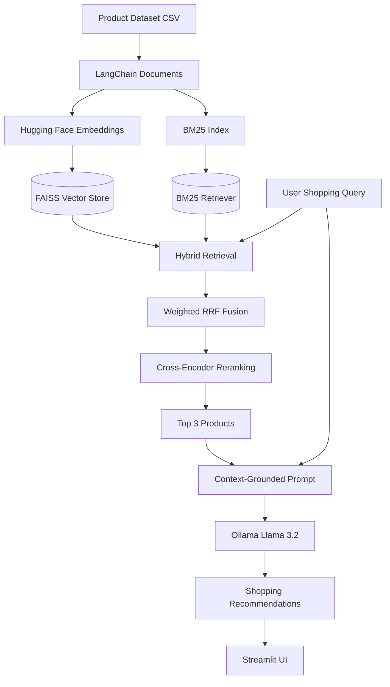

# 🛒 E-commerce RAG Shopping Assistant — Local & Free

**Hybrid Retrieval (FAISS + BM25 + RRF) | Cross-Encoder Reranking | Ollama | Streamlit**

An intelligent AI-powered shopping assistant built using **Python, LangChain, FAISS, BM25, Hugging Face, and Ollama**.

The system understands natural-language shopping queries, retrieves relevant products from a local product catalog, reranks the results, and generates grounded recommendations using a locally running Llama 3.2 model.

**GitHub Repository:** [Rag-Pipeline-](https://github.com/aaditya246/Rag-Pipeline-)

The main shopping assistant runs locally without a paid Gemini API, Google Cloud billing, or an external vector database.

---

## ✨ Key Features

- **Hybrid Retrieval:** Combines semantic vector search (FAISS) and keyword-based search (BM25).
- **Reciprocal Rank Fusion:** Merges and ranks results from both retrieval methods.
- **Cross-Encoder Reranking:** Uses `cross-encoder/ms-marco-MiniLM-L-6-v2` to identify the three most relevant products.
- **Multilingual Embeddings:** Uses `paraphrase-multilingual-MiniLM-L12-v2` for multilingual semantic retrieval.
- **Local AI Generation:** Uses Llama 3.2 3B through Ollama to generate product recommendations.
- **Context-Grounded Responses:** Instructs the LLM to use only retrieved product information.
- **Streamlit Interface:** Provides an interactive web-based shopping assistant.
- **Modular Architecture:** Separates offline indexing, retrieval, generation, and evaluation.

---

## 🏗️ System Architecture



### How the system works

1. **Data indexing:** Product records are converted into LangChain Documents and stored in local FAISS and BM25 indexes.
2. **Query processing:** A customer submits a shopping request.
3. **Hybrid retrieval:** FAISS retrieves semantically similar products, while BM25 finds keyword matches.
4. **Rank fusion:** Weighted RRF combines both ranked result sets.
5. **Reranking:** The Cross-Encoder selects the top three most relevant products.
6. **Answer generation:** Ollama receives the retrieved product descriptions and generates recommendations.
7. **Response:** The customer receives product suggestions with descriptions, materials, prices, and reasons for recommendation when those details are available.

---

## 🛠️ Technology Stack

| Layer | Technology |
|---|---|
| Frontend | Streamlit |
| Programming Language | Python |
| AI Framework | LangChain |
| Embedding Model | Hugging Face MiniLM |
| Vector Search | FAISS |
| Keyword Search | BM25 |
| Fusion Strategy | Reciprocal Rank Fusion |
| Reranking | Cross-Encoder MiniLM |
| Large Language Model | Llama 3.2 3B |
| Local LLM Runtime | Ollama |
| Product Data | CSV, Pandas |
| Evaluation | RAGAS (optional, legacy Gemini scripts) |

---

## 📁 Project Structure

```text
Rag-Pipeline-/
├── app.py
├── build_index.py
├── rag_pipeline.py
├── generate_testset.py
├── evaluate_rag.py
├── requirements.txt
├── .gitignore
└── data/
    ├── rag_dataset.csv
    ├── faiss_store/
    ├── bm25_retriever.pkl
    ├── ragas_testset.csv
    └── evaluation_results.csv
```

The index files and evaluation results are generated when their respective scripts run.

### Important files

- `app.py`: Streamlit user interface.
- `build_index.py`: Creates FAISS and BM25 indexes.
- `rag_pipeline.py`: Implements hybrid retrieval, RRF, reranking, prompt construction, and Ollama generation.
- `generate_testset.py`: Generates evaluation questions using the original Gemini-backed RAGAS workflow.
- `evaluate_rag.py`: Calculates RAGAS evaluation metrics using the original Gemini-backed evaluator.
- `requirements.txt`: Python dependency list.
- `data/rag_dataset.csv`: Product catalog.

---

## 🚀 Getting Started

### 1. Clone the repository

```bash
git clone https://github.com/aaditya246/Rag-Pipeline-.git
cd Rag-Pipeline-
```

### 2. Create a virtual environment

On Windows PowerShell:

```powershell
py -3.11 -m venv venv
.\venv\Scripts\Activate.ps1
```

If PowerShell blocks activation:

```powershell
Set-ExecutionPolicy -Scope Process -ExecutionPolicy Bypass
.\venv\Scripts\Activate.ps1
```

### 3. Install dependencies

Install the local shopping assistant dependencies:

```powershell
python -m pip install --upgrade pip
python -m pip install streamlit pandas python-dotenv langchain-core langchain-community langchain-huggingface langchain-ollama sentence-transformers faiss-cpu rank-bm25
```

The original `requirements.txt` may contain additional Gemini and RAGAS dependencies. Review package compatibility before using it to reinstall everything.

### 4. Install Ollama

Download Ollama from:

https://ollama.com/download/windows

Verify installation:

```powershell
ollama --version
```

Download the local language model:

```powershell
ollama pull llama3.2:3b
```

Check downloaded models:

```powershell
ollama list
```

### 5. Build the vector indexes

```powershell
python build_index.py
```

This creates the local FAISS vector store and BM25 keyword index.

### 6. Run the RAG backend

```powershell
python rag_pipeline.py
```

Example input:

```text
Suggest a comfortable cotton shirt for summer under $50
```

The application retrieves relevant products and asks the local Ollama model to generate recommendations.

### 7. Launch the Streamlit application

```powershell
streamlit run app.py
```

Open the URL displayed in your terminal, normally:

http://localhost:8501

---

## 💬 Example Queries

Try these shopping queries:

- Recommend a blue cotton shirt for summer.
- Find affordable jeans under $50.
- Suggest a lightweight, breathable dress.
- Show me warm clothes suitable for winter.
- Recommend comfortable casual clothing for daily use.

Product availability and recommendations depend on the data in `rag_dataset.csv`.

---

## 📊 RAGAS Evaluation

The repository includes two optional evaluation scripts:

**`generate_testset.py`**

Generates test questions based on the product catalog.

**`evaluate_rag.py`**

Evaluates the RAG pipeline using four metrics:

| Metric | Description |
|---|---|
| Context Precision | Measures how relevant the retrieved documents are. |
| Context Recall | Measures whether the retrieved context covers the required information. |
| Faithfulness | Measures whether generated answers are supported by retrieved context. |
| Answer Relevancy | Measures how well answers address user questions. |

### Current evaluation status

These scripts still use Gemini for testset generation or evaluation. They require appropriate API credentials and compatible RAGAS dependencies.

The main Ollama-based shopping assistant does **not** require these scripts to operate.

The RAGAS scores published by the original project should not be treated as verified scores for this modified local implementation.

---

## 🔧 Troubleshooting

| Issue | Solution |
|---|---|
| Ollama not recognized | Install Ollama and restart PowerShell. |
| Model not available | Run `ollama pull llama3.2:3b`. |
| Ollama connection refused | Start Ollama or run `ollama serve`. |
| FAISS index missing | Run `python build_index.py`. |
| BM25 index missing | Run `python build_index.py`. |
| LangChain import error | Check installed package versions. |
| Hugging Face download warning | Public model downloads may work without authentication. |
| Google credentials error | Check whether the script still uses Gemini or Google Cloud. |
| Vietnamese interface text | Replace the interface strings inside `app.py`. |

---

## 🔐 Security

- Never commit credentials or `.env` files containing secrets.
- Only load FAISS and BM25 pickle artifacts from trusted sources.
- Local LLM inference does not require sending shopping queries to a paid cloud inference API.
- Internet access is required initially to download Python dependencies and models.

---

## 🔮 Future Improvements

- Fully local RAGAS evaluation using Ollama.
- Reliable price and category filtering.
- Improved conversational follow-up handling.
- Product comparison and filtering.
- Deployment of the frontend and an accessible model-serving backend.

---

## 📌 Conclusion

This project demonstrates an end-to-end **hybrid Retrieval-Augmented Generation system** for intelligent product recommendations.

It combines FAISS semantic retrieval, BM25 keyword search, Reciprocal Rank Fusion, Cross-Encoder reranking, and a local Ollama language model to provide catalog-grounded shopping assistance without requiring a paid LLM API for the main application.